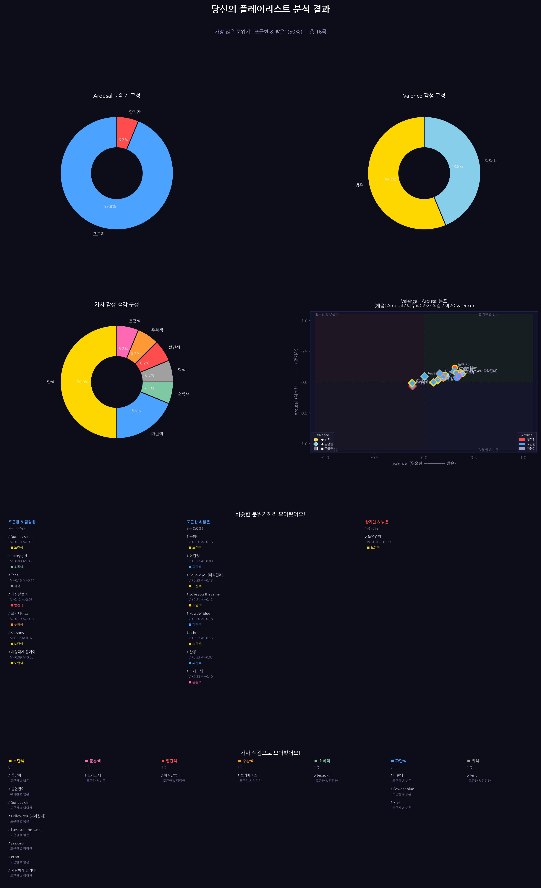

# 플레이리스트 분위기 분석기

플레이리스트(곡명·아티스트)를 넣으면 두 갈래로 분석해 한 장의 결과 이미지로 보여줍니다.

- **가사 → 색**: 멜론 가사 크롤링 → 핵심 키워드 → NRC 8감정 → 9가지 색(노랑·파랑·빨강·보라·초록·갈색·주황·분홍·회색)
- **음원 → 분위기 형용사**: 유튜브 음원 → openSMILE 오디오 피처 24개 → DEAM으로 학습한 딥러닝이 Valence/Arousal 예측 → 형용사(밝은/담담한/우울한 × 활기찬/포근한/차분한)



## 1. 설치 (macOS, Apple Silicon 기준)

```bash
brew install python@3.11 ffmpeg deno     # ffmpeg: 음원 → wav 변환, deno: yt-dlp의 유튜브 다운로드에 필요
# Google Chrome 설치 필요 (멜론 크롤링, 드라이버는 Selenium이 자동으로 받음)

cd Final
python3.11 -m venv .venv
source .venv/bin/activate
pip install -r requirements.txt
python -m spacy download en_core_web_sm
```

> kiwipiepy는 버전마다 형태소 분석 결과가 달라서 0.23.2로 고정했습니다 (0.24는 일부 곡의 색이 바뀜).

## 2. 실행

1. `input/Playlist.csv`에 곡을 적습니다 (헤더: `title,artist`). 곡 2개짜리 예시: `input/test_playlist.csv`

   ```csv
   title,artist
   어린양,검정치마
   seasons,wave to earth
   ```

2. 실행

   ```bash
   python main.py                          # 전체 1~6단계
   python main.py --steps 4-6              # 가사 분석·시각화만 다시 (01·03 산출물이 있어야 함)
   python main.py --skip-crawl             # 가사 크롤링(1단계)만 건너뜀
   python main.py --offline                # 네트워크 단계(1·2) 건너뜀
   python main.py --input input/test_playlist.csv --output-dir outputs/test
   python main.py --steps 3 --retrain      # 모델 다시 학습 (기본은 models/의 저장된 모델 사용)
   python main.py --no-cache               # 가사·오디오 캐시를 무시하고 새로 받음
   ```

| 단계 | 모듈 | 하는 일 | 산출물 (`outputs/`) |
|---|---|---|---|
| 1 | `src/crawl_lyrics.py` | 멜론 가사 크롤링 (Chrome 창이 뜸) | `01_lyrics.csv` (`lyrics_status`: ok / no_result / error …) |
| 2 | `src/audio_features.py` | 유튜브 음원 → 음량 정규화 → openSMILE 피처 24개 | `02_audio_features.csv`, `02_audio_failed.csv` |
| 3 | `src/mood_model.py` | DEAM 5-Fold 학습(최초 1회, `models/`에 저장) + Valence/Arousal 예측 | `03_va_predictions.csv` |
| 4 | `src/lyrics_keywords.py` | 가사 형태소 분석 → 핵심 키워드 | `04_tokens_long.csv`, `04_core_keywords.csv`, `04_keywords_summary.csv` |
| 5 | `src/lyrics_color.py` | 키워드 → 감정 점수 → 대표 색 | `05_matched_emotions.csv`, `05_song_emotion_color.csv` |
| 6 | `src/report.py` | 결과 합치기 + 형용사 + 시각화 | `final_result.csv`, `playlist_analysis.png` |

- 각 단계는 자기 산출물만 새로 쓰고, 곡은 `Playlist.csv`의 행 번호인 `song_id`로 연결됩니다.
- 이미 받은 가사·오디오 피처는 `outputs/cache/`에 저장되어 다음 실행 때 다시 받지 않습니다.
- 실패한 곡은 결과에서 빠지지 않고 '분석 실패'로 표시됩니다 (사유는 `01_lyrics.csv`의 `lyrics_status`, `02_audio_failed.csv`).

## 3. 결과 해석 (`outputs/final_result.csv`)

| 컬럼 | 의미 |
|---|---|
| `valence_mean_pred`, `arousal_mean_pred` | 모델 예측값, DEAM 척도(1~9, 5가 중간). 같은 곡은 항상 같은 값 |
| `valence_label` | 밝은 / 담담한 / 우울한 |
| `arousal_label` | 활기찬 / 포근한 / 차분한 |
| `va_mood` | `arousal_label & valence_label` |
| `valence_score`, `arousal_score` | 그래프 좌표 `(x − 5) / 5` |
| `main_color_text` | 가사 대표 감정의 색 (joy 노랑, sadness 파랑, anger 빨강, fear 보라, trust 초록, disgust 갈색, surprise 주황, anticipation 분홍, 감정 단어 없음 회색) |

**형용사 경계값**: 학습할 때 DEAM 검증 곡 예측을 3등분하는 값입니다 (`models/train_meta.json`의 `label_thresholds`).
현재 모델 기준 Valence 4.56 / 5.34, Arousal 4.40 / 5.35. 모델이 예측을 평균 쪽으로 좁게 내놓기 때문에 원래 규칙(±0.2 = 4 / 6)으로는
대부분이 '포근한·담담한'이 되어 보정했습니다. 원래 규칙을 쓰려면 `config.LABEL_THRESHOLD_MODE = "fixed"`.
자세한 근거는 `docs/phase2_분석.md`.

## 4. 폴더 구조

```
Final/
├── main.py  config.py  requirements.txt  README.md  CHANGELOG.md
├── src/          # 단계별 모듈 (각각 run(cfg) 함수)
├── tools/        # compare_baseline.py, diff_colors.py: 원본 결과와 비교 (가사 원문이 있는 _baseline 로컬 파일 필요)
├── docs/         # phase2_분석.md: 도메인 시프트·척도·임계값 분석
├── input/        # Playlist.csv, test_playlist.csv
├── data/
│   ├── deam_features_mean.csv     # DEAM 1802곡 openSMILE 피처 곡 평균 (학습 X)
│   ├── deam_labels_avg_mood.csv   # DEAM valence/arousal 평균 1~9 (학습 Y)
│   └── Korean-NRC-EmoLex.txt      # NRC EmoLex 한·영 감정 사전
├── models/       # 학습된 5-Fold 모델·스케일러·임계값
├── outputs/      # 단계별 산출물 (cache/는 git 제외)
├── _baseline/    # 리팩터링 전 원본 결과 (비교 기준)
└── 참고자료/      # DEAM 전처리 코드, 노트북, 발표 자료
```

`참고자료/Data process.py`는 DEAM 원본 프레임 피처를 곡별 평균으로 만든 코드입니다 (원본 데이터는 포함되어 있지 않음).

> 저작권 때문에 가사 원문이 들어 있는 파일(`outputs/01_lyrics.csv`, `outputs/cache/`, `_baseline`의 가사 CSV)은 저장소에 올리지 않습니다.
> 1단계를 실행하면 로컬에 다시 만들어집니다.

## 5. 한계
1. 모델 설명력이 낮습니다 (5-Fold R² Valence 0.38 / Arousal 0.43).
2. NRC 한국어 사전은 영어 단어의 기계 번역이라 한국어 동사·형용사의 일부만 매칭됩니다.
3. 음원은 유튜브 검색 첫 결과라 MV 인트로·라이브 버전이 섞일 수 있습니다.

개선 아이디어는 `CHANGELOG.md` 마지막 절을 참고하세요.
